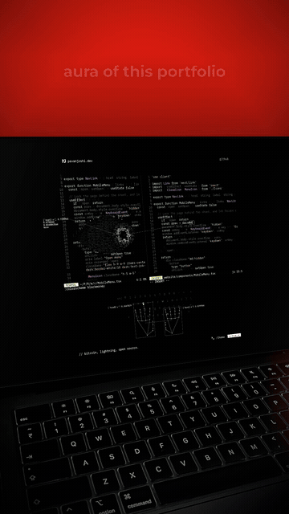
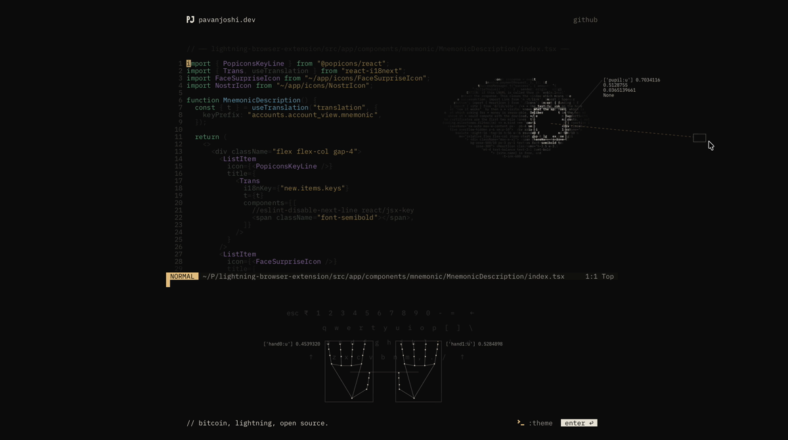
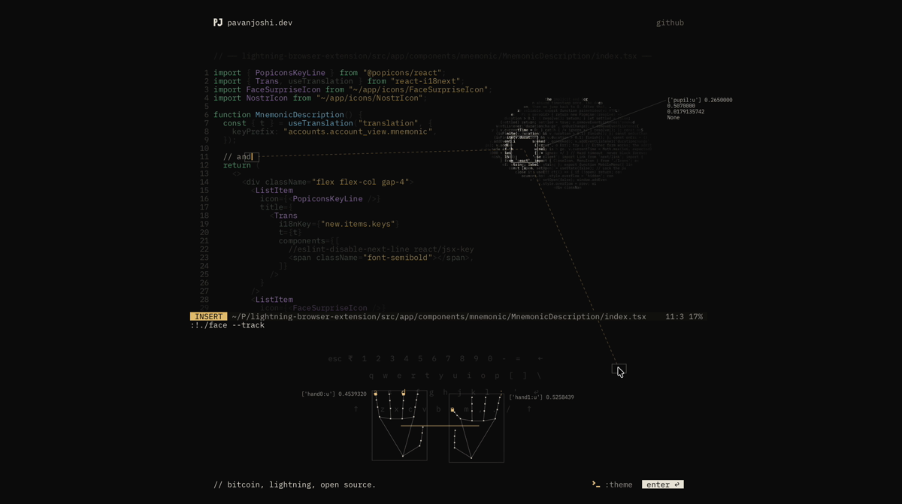
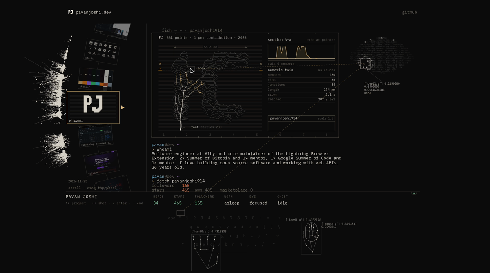
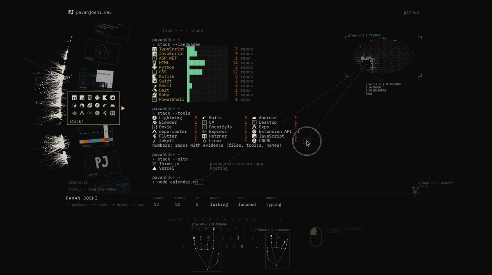

# dev-portfolio-template

A Neovim-inspired developer portfolio template with an animated code-wall intro, interactive terminal-style editor, 8 built-in color themes, contribution calendar, and keyboard-first navigation (`j`/`k`, `:theme`, `enter`).

Zero build step required — pure HTML, CSS, and ES modules.

<p align="center">
  
</p>

<p align="center">
  <a href="./assets/demo.mp4">Watch full HD video (<code>assets/demo.mp4</code>)</a>
</p>

| Intro & Code Wall | Interactive Editor |
| :---: | :---: |
|  |  |
| **Projects & Stack** | **Themes & Terminal** |
|  |  |

---

## Quick Start (With One AI Prompt)

1. Click **"Use this template"** on GitHub (or clone this repo).
2. Open the folder in your AI coding assistant (Cursor, Claude Code, Antigravity, Windsurf, Copilot, etc.).
3. Copy the prompt from **[`AI_PROMPT.md`](./AI_PROMPT.md)**, paste your resume / bio / links / projects at the bottom, and send it.
4. Preview locally:
   ```sh
   python3 serve.py
   ```
   Open `http://localhost:8767/` (intro) and `http://localhost:8767/site/` (editor).

---

## Manual Setup

All personal information, links, work history, projects, and talks live in a single file:

- **`portfolio.config.json`** — edit your `identity`, `about`, `links`, `work`, `projects`, and `talks`.

Then regenerate the site files:

```sh
# Offline mode (updates HTML, JS, SVG, content.json, themes using your config)
node scripts/build-data.mjs

# Online mode (also fetches your real GitHub repos, languages, contribution calendar & code wall via `gh` CLI)
node scripts/build-data.mjs --fetch-github
```

> **Note:** Online mode requires the [GitHub CLI (`gh`)](https://cli.github.com/) to be installed and authenticated (`gh auth login`).

---

## Project Structure

| Path | Purpose |
|---|---|
| `portfolio.config.json` | **Single source of truth** for all your personal info, projects, work, and talks |
| `AI_PROMPT.md` | One-prompt template for AI assistants to personalize the entire site |
| `scripts/build-data.mjs` | Syncs `portfolio.config.json` into HTML/JS/JSON (with optional `--fetch-github`) |
| `index.html`, `glimpse.js`, `glimpse.css` | Landing intro with animated code wall and `:theme` switcher |
| `site/` | Interactive Neovim/terminal-style portfolio (`/site/`) |
| `site/shots/` | Project screenshots (supports `.png`, `.jpg`, `.webp`, `.svg`) |
| `site/photos/` | Optional conference/talk photo galleries |
| `serve.py` | Local dev server with `Cache-Control: no-store` (`python3 serve.py [port]`) |
| `scripts/build-face.py` | Optional script to generate the looping face-tracking intro layer |

---

## Adding Your Own Assets

- **Project Screenshots**: Drop images into `site/shots/` and reference them as `"shots/my-app.png"` in `portfolio.config.json`.
- **Talk Photos**: Drop photos into `site/photos/<event>/` and reference them in `talks[].photos` in `portfolio.config.json`.
- **Custom Logo**: Replace the SVG `<path>` in `favicon.svg`, `index.html`, `site/index.html`, and `MARK` in `site/wheel.js`.
- **Optional Face Intro Layer**: See `scripts/build-face.py` if you want to add a green-screened portrait loop to the intro. Without `face.mp4` / `face.webm` / `face-track.json`, the intro skips the face layer automatically.

---

## Deploy

This is a static site. Deploy the root directory directly to **GitHub Pages**, **Vercel**, **Netlify**, or **Cloudflare Pages** with no build command needed.
